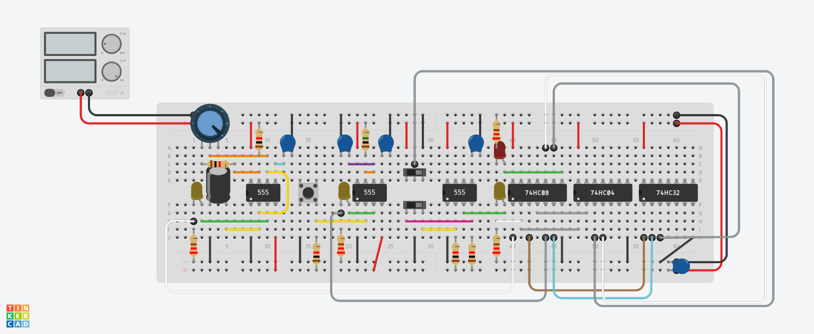

# 8-Bit Breadboard Computer

An 8-bit computer built from logic chips, 555 timers and transistors,
simulated in Tinkercad Circuits and documented step by step, with the
reasoning and calculations behind each part.

**Website:** <https://meshannawod.github.io/8-bit-computer/>

> **Credit:** This project follows the design of **Ben Eater's 8-bit breadboard
> computer**. The architecture, module breakdown and most of the circuit ideas
> are his. Go watch the original series. It is one of the best ways to learn
> how a computer works:
> - Website: <https://eater.net/8bit>
> - YouTube playlist: <https://www.youtube.com/playlist?list=PLowKtXNTBypGqImE405J2565dvjafglHU>
>
> What's mine here: the Tinkercad simulations, the write-ups, and the
> worked calculations.

---

## How the computer works

Every module connects to one shared **8-bit bus**. On each clock pulse, the
control logic lets one module *write* to the bus and one or more modules
*read* from it.

| Module | Job |
|--------|-----|
| Clock | The heartbeat: every step happens on a clock pulse |
| A and B registers | Hold the two numbers being worked on |
| ALU | Adds or subtracts A and B |
| RAM + memory address register | 16 bytes for the program and data |
| Program counter | Points at the next instruction |
| Instruction register | Holds the current instruction |
| Control logic | Decides who uses the bus on each step |
| Output | Shows a number on 7-segment displays |

## Build progress

| # | Module | Main chips | Status | Docs |
|---|--------|------------|--------|------|
| 1 | Clock | LM555 ×3, 74HC04, 74HC08, 74HC32 | ✅ Simulated (parts 1A to 4A) | [Clock docs](docs/clock/README.md) |
| 2 | Registers (A, B, IR) | 74LS173, 74LS245 | ⏳ Planned | — |
| 3 | ALU (add/subtract) | 74LS283, 74LS86 | ⏳ Planned | — |
| 4 | RAM + memory address register | 74LS189, 74LS157, 74LS173 | ⏳ Planned | — |
| 5 | Program counter | 74LS161 | ⏳ Planned | — |
| 6 | Output display | 28C16 EEPROM, 74LS273, 7-segment | ⏳ Planned | — |
| 7 | Control logic | 28C16 EEPROM ×2, 74LS161, 74LS138 | ⏳ Planned | — |

## Module 1: Clock

| Part | What it adds | Key values | Result | Tinkercad | Write-up |
|------|--------------|-----------|--------|-----------|----------|
| 1A | Astable 555 | R1 1 kΩ, R2 100 kΩ, C 1 µF | **7.18 Hz** | [Open](https://www.tinkercad.com/things/l30rW27OBnZ-astable-555-timer-8-bit-computer-clock-part-1-a) | [01-astable.md](docs/clock/01-astable.md) |
| 1B | Speed knob | R2 = 1 kΩ + 1 MΩ pot | **0.72 to 480 Hz** | [Open](https://www.tinkercad.com/things/5Rx0vSOaq2a-astable-555-timer-8-bit-computer-clock-part-1b-) | [01-astable.md](docs/clock/01-astable.md#part-1b-adjustable-speed) |
| 2A | Monostable 555 | R 1 MΩ, C 0.1 µF | **110 ms** per press | [Open](https://www.tinkercad.com/things/hLZbnoHB4L6-monostable-555-timer-8-bit-computer-clock-part-2a) | [02-monostable.md](docs/clock/02-monostable.md) |
| 3 | Plain select switch | SPDT between 1B and 2A | auto / manual | [Open](https://www.tinkercad.com/things/8pzGGpFieEt-bistable-555-timer-8-bit-computer-clock-part-3b) | [03-bistable.md](docs/clock/03-bistable.md#part-3-plain-select-switch) |
| 3C | Bistable 555 | 2 × 1 kΩ pull-ups, SPDT | debounced switch | [Open](https://www.tinkercad.com/things/8nKWwN5A36f-monostable-555-timer-8-bit-computer-clock-part-3c) | [03-bistable.md](docs/clock/03-bistable.md#part-3c-bistable-555) |
| 3B | All three 555s | 1B + 2A + 3C | three LEDs | [Open](https://www.tinkercad.com/things/2x38PAtikeI-bistable-555-timer-8-bit-computer-clock-part-3b) | [03-bistable.md](docs/clock/03-bistable.md#part-3b-all-three-timers) |
| 4A | Clock logic | 74HC04, 74HC08, 74HC32 | one CLK signal | [Open](https://www.tinkercad.com/things/6YHy5r96IyL-clock-logic-8-bit-computer-clock-part-4a) | [04-clock-logic.md](docs/clock/04-clock-logic.md) |

CLK = (AST · SEL + MONO · SEL̅) · HLT̅

All values are read from the Tinkercad board exports in
[`hardware/tinkercad/`](hardware/tinkercad).

## Tinkercad simulations

- Part 1A, astable 555: <https://www.tinkercad.com/things/l30rW27OBnZ-astable-555-timer-8-bit-computer-clock-part-1-a>
- Part 1B, astable with pot: <https://www.tinkercad.com/things/5Rx0vSOaq2a-astable-555-timer-8-bit-computer-clock-part-1b->
- Part 2A, monostable 555: <https://www.tinkercad.com/things/hLZbnoHB4L6-monostable-555-timer-8-bit-computer-clock-part-2a>
- Part 3B, all three 555s: <https://www.tinkercad.com/things/2x38PAtikeI-bistable-555-timer-8-bit-computer-clock-part-3b>
- Part 3C, bistable 555: <https://www.tinkercad.com/things/8nKWwN5A36f-monostable-555-timer-8-bit-computer-clock-part-3c>
- Part 3, plain select switch: <https://www.tinkercad.com/things/8pzGGpFieEt-bistable-555-timer-8-bit-computer-clock-part-3b>
- Part 4A, clock logic: <https://www.tinkercad.com/things/6YHy5r96IyL-clock-logic-8-bit-computer-clock-part-4a>

## Diagrams

Redrawn as clean SVGs from Ben Eater's whiteboard drawings:

| Diagram | Shows |
|---------|-------|
| [555-internals.svg](images/diagrams/555-internals.svg) | Inside the 555: divider, comparators, SR latch, discharge transistor, reset |
| [555-astable.svg](images/diagrams/555-astable.svg) | Astable wiring with 1 kΩ, 100 kΩ, 1 µF and an LED |
| [555-monostable.svg](images/diagrams/555-monostable.svg) | Monostable wiring with 1 MΩ, 0.1 µF and a push button |
| [clock-logic.svg](images/diagrams/clock-logic.svg) | Clock select and halt logic (AND, OR, NOT) |
| [clock-logic-nand.svg](images/diagrams/clock-logic-nand.svg) | The same logic with 7 NAND gates |

## Background reading in this repo

- [How the 555 timer works inside](docs/basics/555-timer.md)
- [Transistors as switches, and building logic gates from them](docs/basics/transistors-and-gates.md)
- [LED current-limiting resistors](docs/basics/led-resistors.md)
- [Parts list](docs/parts-list.md)

## What's in this repository

| Folder or file | Contents |
|----------------|----------|
| `docs/clock/` | Write-ups and calculations for each clock part |
| `docs/basics/` | 555 internals, transistors and gates, LED resistors |
| `docs/parts-list.md` | Parts list for the clock module |
| `hardware/tinkercad/` | Eagle `.brd` exports of each Tinkercad circuit |
| `images/` | Tinkercad breadboard screenshots |
| `images/diagrams/` | Circuit and logic diagrams (SVG) |
| `index.html`, `site.js` | The project website (GitHub Pages) |

## Credits

- **Ben Eater** ([eater.net](https://eater.net), [YouTube](https://www.youtube.com/@BenEater)):
  original 8-bit computer design and video series this project follows.
- Simulations built in [Autodesk Tinkercad Circuits](https://www.tinkercad.com/circuits).
- Datasheets: Texas Instruments NE555 and 74HC/74LS series.

## License

Documentation and simulations: [MIT](LICENSE). The original 8-bit computer
design belongs to Ben Eater; see his site for his terms.
