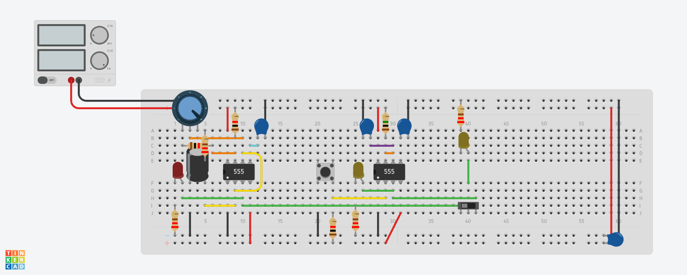
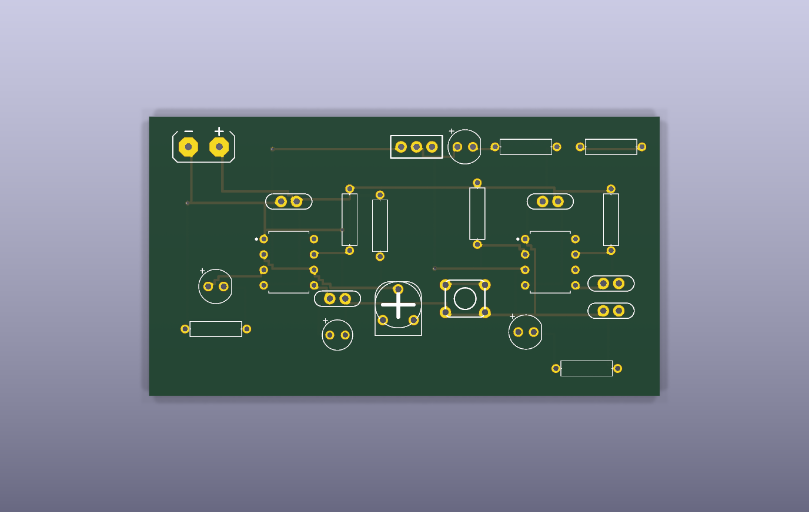

# 8-Bit Breadboard Computer

An 8-bit computer built from logic ICs (74LS series), 555 timers and discrete
transistors, simulated first in Tinkercad Circuits and documented step by step,
with the reasoning and calculations behind each part.

> **Credit:** This project follows the design of **Ben Eater's 8-bit breadboard
> computer**. The architecture, module breakdown and most of the circuit ideas
> are his. Go watch the original series. It is one of the best ways to learn
> how a computer works:
> - Website: <https://eater.net/8bit>
> - YouTube playlist: <https://www.youtube.com/playlist?list=PLowKtXNTBypGqImE405J2565dvjafglHU>
>
> What's mine here: the Tinkercad simulations, the write-ups, and the
> worked calculations.

---

## Architecture overview

```
            ┌──────────────────────── 8-bit BUS ────────────────────────┐
            │                                                            │
 ┌───────┐  │  ┌──────────────┐   ┌──────────────┐   ┌───────────────┐   │
 │ CLOCK │──┼─▶│ Program      │   │ A Register   │──▶│               │   │
 └───────┘  │  │ Counter (PC) │   └──────────────┘   │  ALU (+ / −)  │───┤
            │  └──────────────┘   ┌──────────────┐   │               │   │
            │  ┌──────────────┐   │ B Register   │──▶│               │   │
            ├─▶│ Memory Addr  │   └──────────────┘   └───────────────┘   │
            │  │ Register     │   ┌──────────────┐   ┌───────────────┐   │
            │  └──────┬───────┘   │ Instruction  │──▶│ Control Logic │   │
            │         ▼           │ Register     │   │ (microcode)   │   │
            │  ┌──────────────┐   └──────────────┘   └───────────────┘   │
            └─▶│ RAM (16 B)   │   ┌──────────────┐                       │
               └──────────────┘   │ Output (7seg)│◀──────────────────────┘
                                  └──────────────┘
```

Every module talks to the others over a shared 8-bit bus. Each clock pulse,
the control logic enables one module to *write* to the bus and one or more
modules to *read* from it.

## Build progress

| # | Module | Main ICs | Status | Docs |
|---|--------|----------|--------|------|
| 1 | Clock | LM555 ×3, 74LS04, 74LS08, 74LS32 | 🟡 Astable, monostable and select switch simulated; bistable + logic next | [Clock docs](docs/clock/README.md) |
| 2 | Registers (A, B, IR) | 74LS173, 74LS245 | ⏳ Planned | — |
| 3 | ALU (add/subtract) | 74LS283, 74LS86 | ⏳ Planned | — |
| 4 | RAM + memory address register | 74LS189, 74LS157, 74LS173 | ⏳ Planned | — |
| 5 | Program counter | 74LS161 | ⏳ Planned | — |
| 6 | Output display | 28C16 EEPROM, 74LS273, 7-segment | ⏳ Planned | — |
| 7 | Control logic | 28C16 EEPROM ×2, 74LS161, 74LS138 | ⏳ Planned | — |

## Module 1: Clock



The clock is the computer's heartbeat. It has an adjustable free-running
clock, a debounced single-step button, and a switch to choose between them.

| Part | Key values | Result | Tinkercad | Write-up |
|------|-----------|--------|-----------|----------|
| 1a: Astable 555 | R1 1 kΩ, R2 100 kΩ, C 1 µF | **7.18 Hz**, 50.2 % duty | [Open](https://www.tinkercad.com/things/l30rW27OBnZ-astable-555-timer-8-bit-computer-clock-part-1-a) | [01-astable.md](docs/clock/01-astable.md) |
| 1b: Astable + pot | R1 1 kΩ, R2 1 kΩ + 1 MΩ pot, C 1 µF | **0.72 to 480 Hz** | [Open](https://www.tinkercad.com/things/5Rx0vSOaq2a-astable-555-timer-8-bit-computer-clock-part-1b-) | [01-astable.md](docs/clock/01-astable.md#part-1b-adjustable-speed) |
| 2: Monostable 555 | R 1 MΩ, C 0.1 µF | **110 ms** pulse per press | [Open](https://www.tinkercad.com/things/hLZbnoHB4L6-monostable-555-timer-8-bit-computer-clock-part-2) | [02-monostable.md](docs/clock/02-monostable.md) |
| 3: Clock select | SPDT switch between 1b and 2 | Auto / manual | [Open](https://www.tinkercad.com/things/8pzGGpFieEt-bistable-555-timer-8-bit-computer-clock-part-3) | [03-bistable.md](docs/clock/03-bistable.md) |
| 4: Select + halt logic | 74LS04/08/32 | Next step | — | [04-clock-logic.md](docs/clock/04-clock-logic.md) |

All values come from my Tinkercad board exports in
[`hardware/tinkercad/`](hardware/tinkercad).

## Printed circuit boards

Website with interactive board viewer: <https://meshannawod.github.io/8-bit-computer/#pcb>

Each Tinkercad circuit is also laid out as a real two-layer PCB. The netlist
(which pads connect) is taken unchanged from the Tinkercad export; the parts are
placed neatly and the traces are routed by [`tools/make-pcbs.ps1`](tools/make-pcbs.ps1).
Every board was imported into **KiCad 10** and passes its design-rule check
with **0 errors and 0 unconnected pads**.

| Board | Size | Vias | Files |
|-------|------|------|-------|
| Part 1a: Astable | 46 × 41 mm | 0 | [.brd](hardware/pcb/part1a-astable.brd) · [KiCad](hardware/kicad/part1a-astable.kicad_pcb) · [Gerbers](hardware/gerbers/part1a-astable-gerbers.zip) |
| Part 1b: Astable + pot | 47 × 41 mm | 0 | [.brd](hardware/pcb/part1b-astable-pot.brd) · [KiCad](hardware/kicad/part1b-astable-pot.kicad_pcb) · [Gerbers](hardware/gerbers/part1b-astable-pot-gerbers.zip) |
| Part 2: Monostable | 38 × 43 mm | 0 | [.brd](hardware/pcb/part2-monostable.brd) · [KiCad](hardware/kicad/part2-monostable.kicad_pcb) · [Gerbers](hardware/gerbers/part2-monostable-gerbers.zip) |
| Part 3: Clock select | 84 × 46 mm | 4 | [.brd](hardware/pcb/part3-clock-select.brd) · [KiCad](hardware/kicad/part3-clock-select.kicad_pcb) · [Gerbers](hardware/gerbers/part3-clock-select-gerbers.zip) |

Specs: 0.4 mm traces, 0.2 mm clearance, 0.4/0.8 mm vias, 0.635 mm routing grid.



## Background reading in this repo

- [How the 555 timer works inside](docs/basics/555-timer.md)
- [Transistors as switches, and building logic gates from them](docs/basics/transistors-and-gates.md)
- [LED current-limiting resistors](docs/basics/led-resistors.md)
- [Parts list](docs/parts-list.md)

## Repository layout

```
.
├── README.md                ← you are here
├── docs/
│   ├── basics/              ← 555 internals, transistors, LEDs
│   ├── clock/               ← Module 1 write-ups and calculations
│   └── parts-list.md
├── hardware/
│   ├── tinkercad/           ← original Eagle .brd exports from Tinkercad (unrouted)
│   ├── pcb/                 ← routed 2-layer PCBs (same netlist), Eagle .brd
│   ├── kicad/               ← the same boards as KiCad .kicad_pcb
│   └── gerbers/             ← Gerber + drill zips, ready to order
├── tools/                   ← board generator (place + route) and KiCad import script
├── index.html, site.js      ← the project website (GitHub Pages)
├── images/                  ← breadboard screenshots
└── LICENSE
```

## Credits

- **Ben Eater** ([eater.net](https://eater.net), [YouTube](https://www.youtube.com/@BenEater)):
  original 8-bit computer design and video series this project follows.
- Simulations built in [Autodesk Tinkercad Circuits](https://www.tinkercad.com/circuits).
- Datasheets: Texas Instruments NE555, SN74LS00-series.

## License

Documentation and simulations: [MIT](LICENSE). The original 8-bit computer
design belongs to Ben Eater; see his site for his terms.
