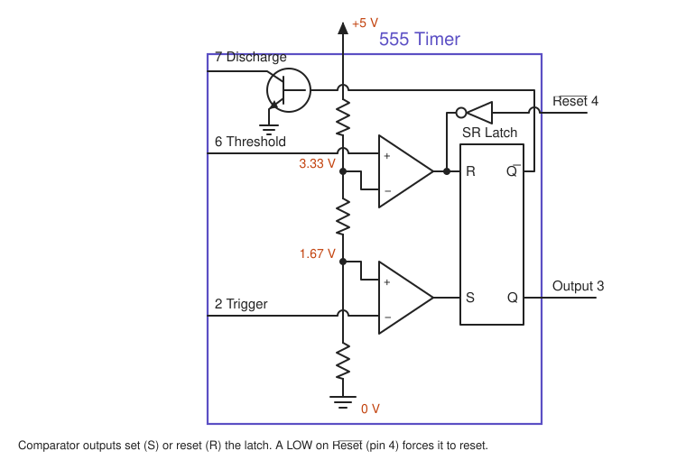

# How the 555 timer works

The 555 is the chip behind all three timers in the clock module. Knowing what
is inside it makes every formula in this repo easy to follow.

## Pins

| Pin | Name | What it does |
|-----|------|--------------|
| 1 | GND | 0 V |
| 2 | TRIG (trigger) | When this drops **below ⅓ VCC**, the output goes HIGH |
| 3 | OUT | Output: about VCC − 1.5 V when HIGH, about 0.1 V when LOW |
| 4 | RESET | Active LOW. Pulling it to 0 V forces the output LOW. Tie to VCC if unused |
| 5 | CTRL (control voltage) | The ⅔ VCC reference point. Put 0.01 to 0.1 µF to ground to filter noise |
| 6 | THRES (threshold) | When this rises **above ⅔ VCC**, the output goes LOW |
| 7 | DISCH (discharge) | A transistor to ground that switches on whenever the output is LOW |
| 8 | VCC | +5 V (works from 4.5 to 16 V) |

Pin 1 is next to the notch or dot on the chip. Pins are numbered
counter-clockwise when looking from the top.

## Inside the chip

*Diagram redrawn from Ben Eater's whiteboard drawing.*

| Block | Job |
|-------|-----|
| Three equal resistors (5 kΩ each in the original chip) | Divide VCC into reference points at **⅓ VCC** and **⅔ VCC** |
| Comparator 1 | Checks whether THRES > ⅔ VCC. If yes, it **resets** the flip-flop, so the output goes LOW |
| Comparator 2 | Checks whether TRIG < ⅓ VCC. If yes, it **sets** the flip-flop, so the output goes HIGH |
| SR flip-flop | Remembers the last state until one comparator fires again |
| Discharge transistor | Turns on while the output is LOW, giving a capacitor a path to ground |
| Output stage | Drives pin 3 with up to about 200 mA |

At VCC = 5 V the two thresholds are **1.67 V** (⅓) and **3.33 V** (⅔).

## The RC formula behind every timing equation

A capacitor charging through a resistor toward a supply voltage follows:

$$V_C(t) = V_{final} - (V_{final} - V_{start})\,e^{-t/RC}$$

Solving for the time to get from `V_start` to `V_end`:

$$t = RC \cdot \ln\!\left(\frac{V_{final} - V_{start}}{V_{final} - V_{end}}\right)$$

| Case | V_start | V_end | V_final | ln(...) | Time |
|------|---------|-------|---------|---------|------|
| **Astable** (between ⅓ and ⅔) | ⅓ VCC | ⅔ VCC | VCC | ln 2 = **0.693** | t = 0.693 RC |
| **Monostable** (from 0 to ⅔) | 0 | ⅔ VCC | VCC | ln 3 = **1.0986** | t ≈ 1.1 RC |

Discharging from ⅔ VCC to ⅓ VCC (toward 0 V) is also ln 2, so 0.693 RC.

**VCC cancels out**: the timing doesn't depend on the supply voltage.

## The three modes used in the clock

| Mode | Stable states | Used for | Doc |
|------|---------------|----------|-----|
| Astable | none (keeps flipping) | Free-running clock | [01-astable.md](../clock/01-astable.md) |
| Monostable | one (returns to LOW) | One clean pulse per button press | [02-monostable.md](../clock/02-monostable.md) |
| Bistable | two (stays where you put it) | Debounced auto/manual switch | [03-bistable.md](../clock/03-bistable.md#part-3c-bistable-555) |
