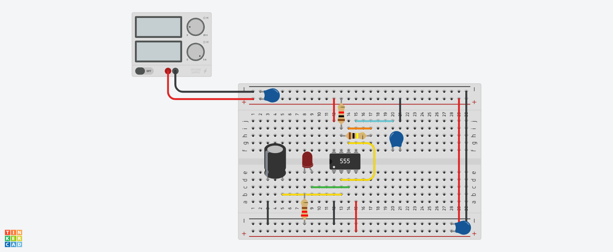

# Part 1: Astable 555 (free-running clock)

**Tinkercad:**
[Part 1a](https://www.tinkercad.com/things/l30rW27OBnZ-astable-555-timer-8-bit-computer-clock-part-1-a) ·
[Part 1b](https://www.tinkercad.com/things/5Rx0vSOaq2a-astable-555-timer-8-bit-computer-clock-part-1b-) ·
Board files: [part1a-astable.brd](../../hardware/tinkercad/part1a-astable.brd), [part1b-astable-pot.brd](../../hardware/tinkercad/part1b-astable-pot.brd)

In **astable** mode the 555 has no stable state. It keeps flipping its
output HIGH and LOW by itself, which produces a square wave. That square
wave is the automatic clock.

## Part 1a: fixed resistors



### Circuit (from the Tinkercad export)

```
 +5V ──┬────────────┬──────────┐
       │            │          │
     [R1 1k]      pin 8      pin 4 (RST tied HIGH)
       │          (VCC)
       ├──────── pin 7 (DISCH)
       │
    [R2 100k]
       │
       ├──────── pin 6 (THRES) ─┐
       │                        ├─ tied together
       ├──────── pin 2 (TRIG) ──┘
       │
    [C3 1µF]+              pin 5 ──[C1 0.1 µF]── GND
       │                   pin 3 ──▶|(red LED)──[R3 220 Ω]── GND
 GND ──┴───────── pin 1
```

| Part | Value | Role |
|------|-------|------|
| U1 | LM555 | Timer |
| R1 | 1 kΩ | Charge path from VCC to the discharge pin |
| R2 | 100 kΩ | Sets most of the timing |
| C3 | 1 µF electrolytic | Timing capacitor |
| C1 | 0.1 µF | Filters noise on the control-voltage pin (pin 5) |
| C2, C4 | 0.1 µF | Power-rail decoupling, one at each end of the breadboard |
| D1 + R3 | red LED + 220 Ω | Shows the clock pulses |

### How it works, step by step

1. At power-on C3 is empty (0 V). TRIG (pin 2) is below ⅓ VCC, so the
   output goes **HIGH** and the discharge transistor turns **off**.
2. C3 **charges** through **R1 + R2**.
3. When V_C reaches **⅔ VCC (3.33 V)**, the threshold comparator fires. The
   output goes **LOW** and the discharge transistor turns **on**.
4. C3 now **discharges** through **R2 only**, into pin 7.
5. When V_C falls to **⅓ VCC (1.67 V)**, the trigger comparator fires. The
   output goes **HIGH** again, the discharge transistor turns off, and the
   cycle repeats from step 2.

```
 V_C  3.33 ┤   /\    /\    /\
           │  /  \  /  \  /  \
      1.67 ┤ /    \/    \/    \
           │/
 OUT    5  ┤ ┌───┐  ┌───┐  ┌───┐
        0  ┤─┘   └──┘   └──┘   └──
             t_H  t_L
```

### Formulas

Moving between ⅓ and ⅔ VCC always takes **ln 2 ≈ 0.693** time constants
(derivation in [555-timer.md](../basics/555-timer.md)):

| Quantity | Formula |
|----------|---------|
| HIGH time (charging through R1 + R2) | t_H = 0.693 × (R1 + R2) × C |
| LOW time (discharging through R2) | t_L = 0.693 × R2 × C |
| Period | T = t_H + t_L = 0.693 × (R1 + 2R2) × C |
| Frequency | f = 1 / T = **1.44 / ((R1 + 2R2) × C)** |
| Duty cycle | D = t_H / T = (R1 + R2) / (R1 + 2R2) |

### Calculation

R1 = 1 kΩ, R2 = 100 kΩ, C = 1 µF

| Step | Working | Result |
|------|---------|--------|
| t_H | 0.693 × (1 000 + 100 000) × 1×10⁻⁶ | **70.0 ms** |
| t_L | 0.693 × 100 000 × 1×10⁻⁶ | **69.3 ms** |
| T | 70.0 + 69.3 | **139.3 ms** |
| f | 1 ÷ 0.1393 | **7.18 Hz** |
| Duty cycle | 101 k ÷ 201 k | **50.2 %** |

**Why R1 is small:** the HIGH time always includes R1, so the duty cycle can
never be exactly 50 %. Keeping R1 much smaller than R2 makes HIGH and LOW
nearly equal, which is what a clock should look like.

**Why R1 can't be 0:** when the discharge transistor turns on, it would short
VCC straight to ground. 1 kΩ limits that current to 5 V ÷ 1 kΩ = **5 mA**.

**LED current:** the 555's HIGH output is about 3.3 V, so
I = (3.3 − 2.0) ÷ 220 Ω ≈ **5.9 mA**.

## Part 1b: adjustable speed


Part 1b replaces the fixed 100 kΩ R2 with **a 1 kΩ resistor (R4) in series
with a 1 MΩ potentiometer** wired as a variable resistor (one end + wiper).
Everything else is the same as 1a.

```
 pin 7 (DISCH) ──[R4 1k]──[RPOT1 1M, wiper]── pin 6 / pin 2 ──[C3 1µF]── GND
```

So R2 = 1 kΩ + R_pot, where R_pot goes from 0 to 1 MΩ.

**Why the extra 1 kΩ?** Without it, turning the pot to zero makes R2 = 0. The
LOW time becomes 0.693 × 0 × C = 0, and when the discharge transistor turns
on, the capacitor is connected straight to pin 7. R4 keeps a minimum R2 of
1 kΩ, which gives a well-defined top speed and protects the discharge
transistor.

### Calculation across the pot's range

R1 = 1 kΩ, R2 = 1 kΩ + R_pot, C = 1 µF

| Pot setting | R2 | t_H | t_L | f | Duty |
|-------------|----|-----|-----|---|------|
| Max (1 MΩ) | 1.001 MΩ | 0.694 s | 0.694 s | **0.72 Hz** | 50.0 % |
| ½ (500 kΩ) | 501 kΩ | 0.348 s | 0.347 s | **1.44 Hz** | 50.1 % |
| 10 % (100 kΩ) | 101 kΩ | 70.7 ms | 70.0 ms | **7.11 Hz** | 50.2 % |
| 1 % (10 kΩ) | 11 kΩ | 8.32 ms | 7.62 ms | **62.7 Hz** | 52.2 % |
| Min (0 Ω) | 1 kΩ | 1.39 ms | 0.69 ms | **481 Hz** | 66.7 % |

Worked example for the minimum setting:
f = 1.44 ÷ ((1 000 + 2 × 1 000) × 1×10⁻⁶) = 1.44 ÷ 0.003 = **480 Hz**
(481 Hz with the unrounded 1/ln 2 constant).
Duty = (1 k + 1 k) ÷ (1 k + 2 k) = **66.7 %**.

So one knob covers a range of about **0.7 Hz to 480 Hz**, nearly 670×. At
the slow end you can watch each instruction step; at the fast end the
computer runs programs quickly.

**Want it faster?** Swap C3 for 0.1 µF and every frequency goes up 10×.

## Checking it in the simulation

- The red LED on pin 3 should blink about 7 times a second in 1a.
- In 1b, turning the pot should change the speed smoothly from below 1 Hz
  upward. Above about 20 Hz the LED looks constantly lit.
- Put Tinkercad's oscilloscope on pin 3 to measure t_H and t_L and compare
  them with the tables.

---
*Design credit: Ben Eater, "Astable 555 timer" (8-bit computer clock module).*
