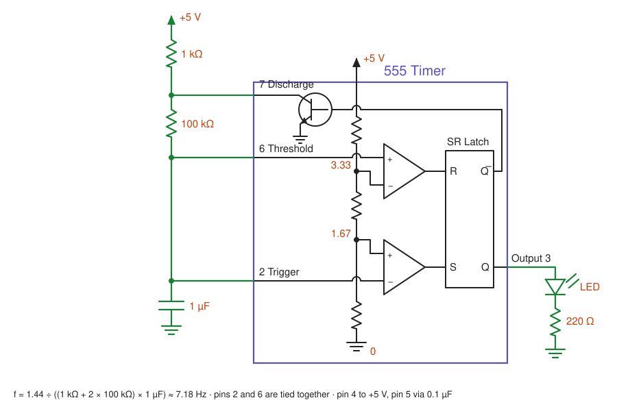
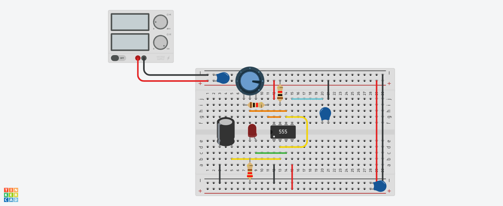

# Part 1: Astable 555 (free-running clock)

**Tinkercad:**
[Part 1A](https://www.tinkercad.com/things/l30rW27OBnZ-astable-555-timer-8-bit-computer-clock-part-1-a) ·
[Part 1B](https://www.tinkercad.com/things/5Rx0vSOaq2a-astable-555-timer-8-bit-computer-clock-part-1b-) ·
Board files: [part1a-astable.brd](../../hardware/tinkercad/part1a-astable.brd), [part1b-astable-pot.brd](../../hardware/tinkercad/part1b-astable-pot.brd)

In **astable** mode the 555 has no stable state. It keeps flipping its
output HIGH and LOW by itself, which makes a square wave. That square wave is
the automatic clock.

## Part 1A: fixed resistors

### Circuit

*Diagram redrawn from Ben Eater's whiteboard drawing. External parts are green.*

### Connections (from the Tinkercad export)

| 555 pin | Connected to |
|---------|--------------|
| 1 GND | Ground |
| 2 TRIG and 6 THRES | Tied together; R2 and the + side of C3 |
| 3 OUT | Red LED D1, then R3 (220 Ω) to ground |
| 4 RESET | +5 V (always enabled) |
| 5 CTRL | C1 (0.1 µF), other side to +5 V |
| 7 DISCH | Between R1 and R2 |
| 8 VCC | +5 V |

| Part | Value | Role |
|------|-------|------|
| R1 | 1 kΩ | From +5 V to pin 7 |
| R2 | 100 kΩ | From pin 7 to pins 2/6; sets most of the timing |
| C3 | 1 µF electrolytic | Timing capacitor, pins 2/6 to ground |
| C1 | 0.1 µF | Noise filter on pin 5 |
| C2, C4 | 0.1 µF | Power-rail decoupling at each end of the breadboard |
| D1 + R3 | red LED + 220 Ω | Shows the clock |

### How it works

1. At power-on C3 is empty, so TRIG is below ⅓ VCC. The output goes
   **HIGH** and the discharge transistor turns **off**.
2. C3 **charges** through **R1 + R2**.
3. At **⅔ VCC (3.33 V)** the threshold comparator fires: output **LOW**,
   discharge transistor **on**.
4. C3 **discharges** through **R2 only** into pin 7.
5. At **⅓ VCC (1.67 V)** the trigger comparator fires: output **HIGH** again,
   and the cycle repeats.

The website has an interactive chart of this capacitor voltage and the
output: <https://meshannawod.github.io/8-bit-computer/#clock>

### Formulas

Moving between ⅓ and ⅔ VCC takes **ln 2 ≈ 0.693** time constants
(derivation in [555-timer.md](../basics/555-timer.md)).

| Quantity | Formula |
|----------|---------|
| HIGH time | t_H = 0.693 × (R1 + R2) × C |
| LOW time | t_L = 0.693 × R2 × C |
| Period | T = 0.693 × (R1 + 2R2) × C |
| Frequency | f = 1.44 ÷ ((R1 + 2R2) × C) |
| Duty cycle | D = (R1 + R2) ÷ (R1 + 2R2) |

### Calculation

R1 = 1 kΩ, R2 = 100 kΩ, C = 1 µF

| Step | Working | Result |
|------|---------|--------|
| t_H | 0.693 × 101 000 × 0.000001 | **70.0 ms** |
| t_L | 0.693 × 100 000 × 0.000001 | **69.3 ms** |
| T | 70.0 + 69.3 | **139.3 ms** |
| f | 1 ÷ 0.1393 | **7.18 Hz** |
| Duty cycle | 101 k ÷ 201 k | **50.2 %** |

- **Why R1 is small:** HIGH time includes R1 but LOW time doesn't, so a small
  R1 keeps the duty cycle close to 50 %.
- **Why R1 isn't 0:** when the discharge transistor turns on it would short
  +5 V to ground. 1 kΩ limits that to 5 V ÷ 1 kΩ = **5 mA**.
- **LED current:** (≈3.3 V − 2.0 V) ÷ 220 Ω ≈ **5.9 mA**.

## Part 1B: adjustable speed

R2 becomes **R4 (1 kΩ) in series with a 1 MΩ potentiometer** (one end plus
the wiper). Everything else is the same as 1A.

So R2 = 1 kΩ + R_pot, where R_pot goes from 0 to 1 MΩ.

**Why the extra 1 kΩ?** With the pot at zero, R2 would be 0 and the LOW time
would be zero. The capacitor would then be connected straight to the discharge
transistor. R4 keeps R2 at 1 kΩ or more.

| Pot setting | R2 | t_H | t_L | f | Duty |
|-------------|----|-----|-----|---|------|
| Max (1 MΩ) | 1.001 MΩ | 0.694 s | 0.694 s | **0.72 Hz** | 50.0 % |
| ½ (500 kΩ) | 501 kΩ | 0.348 s | 0.347 s | **1.44 Hz** | 50.1 % |
| 10 % (100 kΩ) | 101 kΩ | 70.7 ms | 70.0 ms | **7.11 Hz** | 50.2 % |
| 1 % (10 kΩ) | 11 kΩ | 8.32 ms | 7.62 ms | **62.7 Hz** | 52.2 % |
| Min (0 Ω) | 1 kΩ | 1.39 ms | 0.69 ms | **481 Hz** | 66.7 % |

Worked example at the minimum setting:
f = 1.44 ÷ ((1 000 + 2 × 1 000) × 0.000001) = 1.44 ÷ 0.003 = **480 Hz**.

One knob covers about **0.7 Hz to 480 Hz**, a range of nearly 670×.

**Note:** in parts 1A and 1B, the pin 5 capacitor (C1) goes to **+5 V**. In
the later parts it goes to **ground**, which is what the 555 datasheet and Ben
Eater use. Both filter noise, but ground is the standard choice.

---
*Design credit: Ben Eater, "Astable 555 timer" (8-bit computer clock module).*
