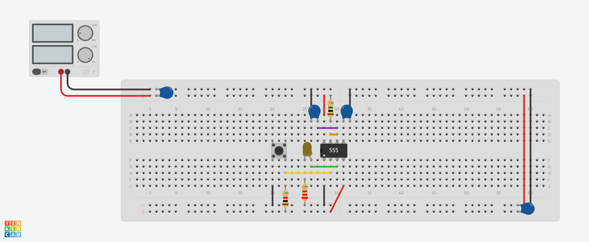

# Part 2: Monostable 555 (debounced single-step button)

**Tinkercad:** [Part 2](https://www.tinkercad.com/things/hLZbnoHB4L6-monostable-555-timer-8-bit-computer-clock-part-2) ·
Board file: [part2-monostable.brd](../../hardware/tinkercad/part2-monostable.brd)



## The problem: switch bounce

When you press a mechanical push button, the metal contacts **bounce**. They
make and break contact several times over 1 to 10 ms before they settle:

```
 What you meant:    ‾‾‾‾‾‾‾‾|________________
 What you get:      ‾‾‾‾‾‾‾‾|_|‾|_||‾|________
                            └ bounce ┘
```

The computer would count each bounce as a separate clock pulse, so one press
could advance the program several steps. We need **one press → exactly one
pulse**.

## The fix: monostable mode

In **monostable** mode the 555 has one stable state (output LOW). A trigger
kicks it into the HIGH state for a **fixed time** set by R and C, and then it
returns to LOW on its own. Bounces during that time are ignored, because the
output is already HIGH.

## Circuit (from the Tinkercad export)

```
 +5V ──┬──────────┬──────────────┬─────────┐
       │          │              │         │
    [R4 1k]     pin 8          pin 4     [R6 1M]
       │        (VCC)        (RST HIGH)    │
       ├── pin 2 (TRIG)                    ├── pin 7 (DISCH)
       │                                   ├── pin 6 (THRES)
     [S1 push button]                      │
       │                                [C5 0.1µF]
 GND ──┴──────── pin 1 ────────────────────┘

 pin 5 ──[C6 100 nF]── GND
 pin 3 ──▶|(yellow LED)──[R5 220 Ω]── GND
```

| Part | Value | Role |
|------|-------|------|
| U1 | LM555 | Timer |
| R4 | 1 kΩ | Pull-up. Holds TRIG HIGH until the button pulls it LOW |
| S1 | momentary push button | Pulls TRIG to GND when pressed |
| R6 | 1 MΩ | Timing resistor |
| C5 | 0.1 µF | Timing capacitor |
| C6 | 100 nF (= 0.1 µF) | Control-pin (pin 5) noise filter |
| C2, C4 | 0.1 µF | Power-rail decoupling |
| D2 + R5 | yellow LED + 220 Ω | Shows the output pulse |

## How it works, step by step

1. **Idle:** TRIG is held HIGH by R4 and the output is LOW. The discharge
   transistor is ON, which keeps C5 shorted at 0 V.
2. **Button pressed:** TRIG drops below ⅓ VCC, the flip-flop is set, and the
   output goes **HIGH**. The discharge transistor turns **OFF**.
3. C5 charges through R6 from **0 V** toward VCC. Contact bounces on TRIG
   change nothing, because the flip-flop is already set.
4. When V_C reaches **⅔ VCC**, the threshold comparator resets the
   flip-flop. The output goes **LOW**, the discharge transistor dumps C5
   back to 0 V, and the circuit is ready for the next press.

## Formula

The capacitor charges from 0 to ⅔ VCC (see [555-timer.md](../basics/555-timer.md)):

$$t = RC \cdot \ln\left(\frac{V_{CC} - 0}{V_{CC} - \tfrac{2}{3}V_{CC}}\right) = RC \ln 3 \approx \mathbf{1.1 \cdot R \cdot C}$$

## Calculation

R6 = 1 MΩ, C5 = 0.1 µF

| Step | Working | Result |
|------|---------|--------|
| Time constant RC | 1 000 000 × 0.1×10⁻⁶ | 0.1 s |
| Pulse width | 1.0986 × 0.1 s | **≈ 110 ms** |
| Fastest stepping rate | 1 ÷ 0.110 s | about 9 presses per second |
| Pull-up current when pressed | 5 V ÷ 1 kΩ | 5 mA |
| LED current | (3.3 − 2.0) V ÷ 220 Ω | ≈ 5.9 mA |

### Why 110 ms is a good choice

- It is **about 10× longer than the worst bounce** (~10 ms), so bounces
  can't leak through.
- It is **shorter than a human double-press** (~200 ms or more), so no
  presses get lost.
- It is long enough for the yellow LED to flash visibly.

| R | C | Pulse width | Notes |
|---|---|-------------|-------|
| 1 MΩ | 1 µF | 1.1 s | Very slow stepping |
| **1 MΩ** | **0.1 µF** | **110 ms** | **This build** |
| 100 kΩ | 0.1 µF | 11 ms | Close to the bounce limit, risky |

## Caveat: holding the button down

If you hold the button longer than 110 ms, TRIG is still LOW when the timer
ends, so the output stays HIGH until you let go. That's fine for
single-stepping. The pulse is always *at least* 110 ms long, and there's still
only one pulse per press.

---
*Design credit: Ben Eater, "Monostable 555 timer" (8-bit computer clock module).*
