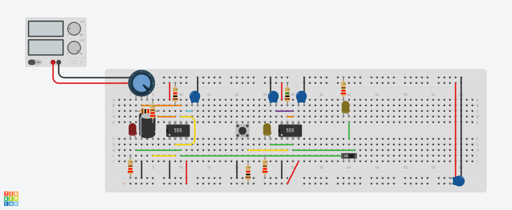
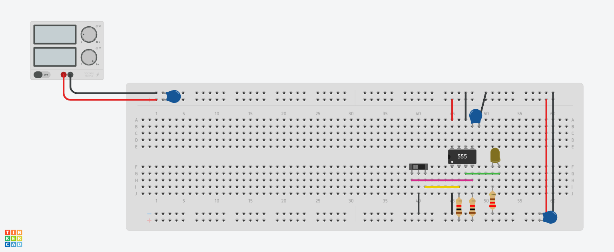
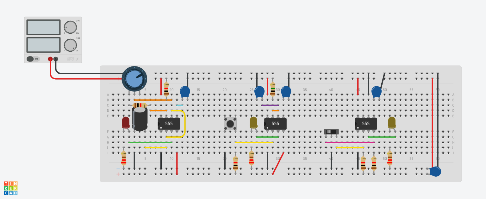

# Part 3: Choosing auto or manual, and the bistable 555

Part 3 was built in three steps:

| Step | What it is | Tinkercad | Board file |
|------|------------|-----------|------------|
| 3 | Astable + monostable, chosen by a plain slide switch | [Open](https://www.tinkercad.com/things/8pzGGpFieEt-bistable-555-timer-8-bit-computer-clock-part-3b) | [part3-select-switch.brd](../../hardware/tinkercad/part3-select-switch.brd) |
| 3C | A bistable 555 on its own | [Open](https://www.tinkercad.com/things/8nKWwN5A36f-monostable-555-timer-8-bit-computer-clock-part-3c) | [part3c-bistable.brd](../../hardware/tinkercad/part3c-bistable.brd) |
| 3B | All three 555 timers together | [Open](https://www.tinkercad.com/things/2x38PAtikeI-bistable-555-timer-8-bit-computer-clock-part-3b) | [part3b-three-555.brd](../../hardware/tinkercad/part3b-three-555.brd) |

## Part 3: plain select switch

The astable from [Part 1B](01-astable.md#part-1b-adjustable-speed) and the
monostable from [Part 2A](02-monostable.md) on one board. An SPDT slide switch
(S2) connects either output to a yellow LED (D3 + R7 220 Ω), which shows the
selected clock.

| Switch position | Selected clock |
|-----------------|----------------|
| Pin 1 side | Astable (automatic) |
| Pin 3 side | Monostable (step button) |

**The problem:** the clock signal itself passes through the switch's
contacts. When you slide the switch, those contacts bounce, which can make
extra clock edges. The fix is the bistable 555 below.

R8 (220 Ω) in this file has both leads on the same row, so it carries no
current and can be removed.

## Part 3C: bistable 555

In **bistable** mode the 555 is used only as its internal SR flip-flop: no
timing resistor or capacitor. It has two stable states and stays in
whichever one it was last put into.

### Connections (from the Tinkercad export)

| 555 pin | Connected to |
|---------|--------------|
| 1 GND | Ground |
| 2 TRIG | R8 (1 kΩ) to +5 V, and slide switch S2 pin 3 |
| 3 OUT | Yellow LED D3, then R7 (220 Ω) to ground |
| 4 RESET | R9 (1 kΩ) to +5 V, and S2 pin 1 |
| 5 CTRL | C7 (0.1 µF) to ground |
| 6 THRES | Ground (so it never resets by itself) |
| 7 DISCH | Not used |
| 8 VCC | +5 V |
| S2 middle pin | Ground |

### Truth table

| Switch connects ground to | TRIG | RESET | Output |
|---------------------------|------|-------|--------|
| Pin 3 → TRIG | LOW | HIGH | **HIGH** (set) |
| Pin 1 → RESET | HIGH | LOW | **LOW** (reset) |
| Nothing (mid-travel or bouncing) | HIGH | HIGH | **keeps last value** |

The first contact latches the flip-flop. Bounces after that only pull the
same pin LOW again, which changes nothing, so the output switches **exactly
once**.

### Calculations

| Quantity | Working | Result |
|----------|---------|--------|
| Pull-up current when grounded | 5 V ÷ 1 kΩ | 5 mA |
| Power in that pull-up | 5 V × 5 mA | 25 mW (a ¼ W resistor is fine) |
| TRIG threshold | ⅓ × 5 V | 1.67 V, and the grounded pin is at 0 V |
| LED current | (≈3.3 − 2.0) V ÷ 220 Ω | ≈ 5.9 mA |

## Part 3B: all three timers

Part 3B places the astable (U2), monostable (U1) and bistable (U3) side by
side on one breadboard, sharing power and ground. Each has its own LED:

| Timer | Values | LED shows |
|-------|--------|-----------|
| U2 astable | R1 1 kΩ, R3 1 kΩ + RPOT2 1 MΩ, C3 1 µF | Red D1: free-running clock, 0.72 to 480 Hz |
| U1 monostable | R6 1 MΩ, C5 0.1 µF, button pull-up R4 1 kΩ | Yellow D2: 110 ms pulse per press |
| U3 bistable | Pull-ups R8, R9 1 kΩ, switch S2 | Yellow D3: mode select (HIGH or LOW) |

All three CTRL pins have 0.1 µF to ground here. The three outputs are not
combined yet. That's the job of the logic gates in
[Part 4A](04-clock-logic.md).

---
*Design credit: Ben Eater, 8-bit computer clock module ("Bistable 555 timer" video).*
