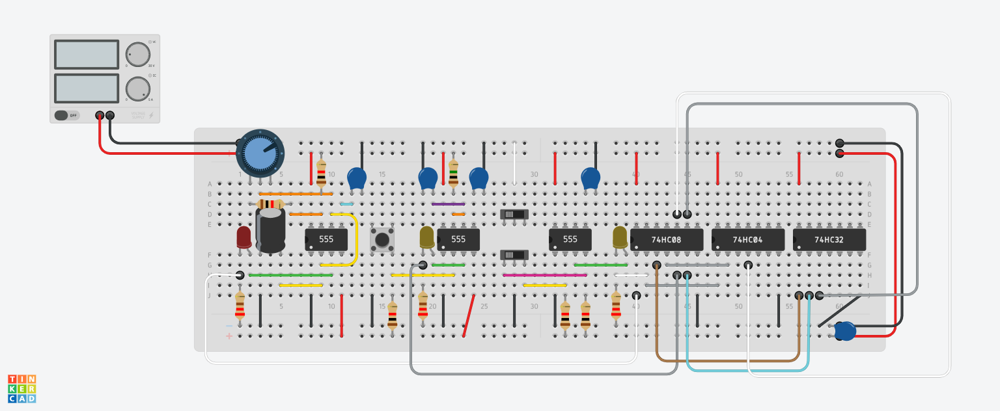
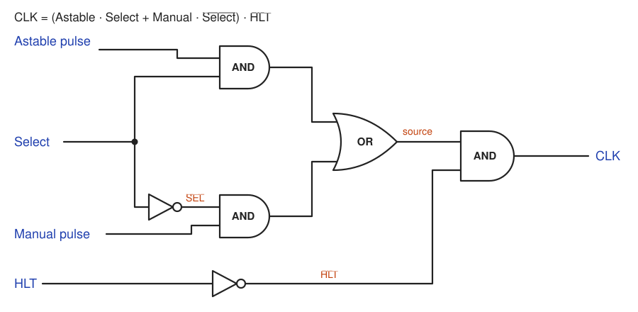
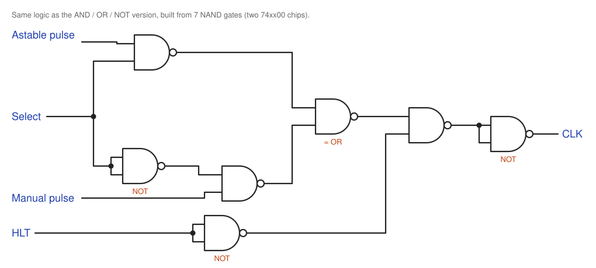

# Part 4A: Clock logic (74HC04, 74HC08, 74HC32)

**Tinkercad:** [Part 4A](https://www.tinkercad.com/things/6YHy5r96IyL-clock-logic-8-bit-computer-clock-part-4a) ·
Board files: [part4a-clock-logic.brd](../../hardware/tinkercad/part4a-clock-logic.brd),
[part4a-clock-logic-halt.brd](../../hardware/tinkercad/part4a-clock-logic-halt.brd) (adds a HLT switch and a CLK LED)

Part 4A adds three logic chips that combine the three 555 timers from
[Part 3B](03-bistable.md#part-3b-all-three-timers) into one clock signal.

| Signal | Comes from | Meaning |
|--------|------------|---------|
| AST | Astable 555 (U7) | Free-running square wave |
| MONO | Monostable 555 (U8) | One pulse per button press |
| SEL | Bistable 555 (U9) | HIGH = automatic, LOW = manual |
| HLT | Toggle switch S1 (halt version) | HIGH = stop the clock |

## The Boolean equation

Traced from the board file:

$$CLK = \big[(AST \cdot SEL) + (MONO \cdot \overline{SEL})\big] \cdot \overline{HLT}$$

The first part is a **2-to-1 multiplexer** made from gates: SEL picks which
input reaches the output. The last AND gate blocks the clock while HLT is HIGH.

## Logic diagram

## The same logic with only NAND gates

A NAND gate can make every other gate: a NAND with both inputs tied together is a NOT, and NAND-ing two inverted signals gives an OR (De Morgan's law: A + B = NOT(NOT A · NOT B)). So the whole clock logic fits in **7 NAND gates**, which is two 74xx00 chips instead of three different chips.

| NAND gate | Inputs | Acts as |
|-----------|--------|---------|
| 1 | Astable, Select | NOT(Astable · Select) |
| 2 | Select, Select | NOT Select |
| 3 | NOT Select, Manual | NOT(Manual · NOT Select) |
| 4 | gate 1, gate 3 | OR of the two terms |
| 5 | HLT, HLT | NOT HLT |
| 6 | gate 4, gate 5 | NOT(source · NOT HLT) |
| 7 | gate 6, gate 6 | NOT, giving CLK |

*Both diagrams redrawn from Ben Eater's whiteboard drawings.*

## Gate-by-gate wiring

| Chip | Gate | Inputs | Output goes to |
|------|------|--------|----------------|
| U4 74HC04 (NOT) | 1 | SEL | U6 gate 2, input A (= SEL̅) |
| U4 74HC04 (NOT) | 2 | HLT (S1 in the halt version) | U6 gate 3, input B (= HLT̅) |
| U6 74HC08 (AND) | 1 | AST, SEL | U5 gate 1, input A |
| U6 74HC08 (AND) | 2 | SEL̅, MONO | U5 gate 1, input B |
| U5 74HC32 (OR) | 1 | AND 1, AND 2 | U6 gate 3, input A |
| U6 74HC08 (AND) | 3 | OR output, HLT̅ | **CLK** (red LED D1 in the halt version) |

## Truth table

| SEL | HLT | AST | MONO | CLK | Why |
|-----|-----|-----|------|-----|-----|
| 1 | 0 | 0 | x | 0 | auto mode, follows AST |
| 1 | 0 | 1 | x | **1** | auto mode, follows AST |
| 0 | 0 | x | 0 | 0 | manual mode, follows MONO |
| 0 | 0 | x | 1 | **1** | manual mode, follows MONO |
| x | 1 | x | x | 0 | halted |

(x = doesn't matter)

## Chips and gate count

| Chip | Gates used | Spare gates |
|------|-----------|-------------|
| 74HC04 (hex NOT) | 2 of 6 | 4 |
| 74HC08 (quad AND) | 3 of 4 | 1 |
| 74HC32 (quad OR) | 1 of 4 | 3 |

This build uses **74HC** (CMOS) chips, while Ben Eater uses **74LS** (TTL).
Both work at 5 V. HC inputs draw almost no current, but they need a clear
HIGH (above 3.5 V) and LOW (below 1.5 V).

## Things to check in this circuit

1. **LEDs in series with gate inputs.** Each 555 output goes through its
   LED into the gate input, with 220 Ω from that point to ground. The gate
   then sees the 555's HIGH output minus the LED drop:
   about 3.5 V − 2.0 V ≈ **1.5 V**. That is below the 74HC minimum HIGH of
   3.5 V, so a real chip may read it as LOW. Tinkercad may still simulate it
   as working. The safer wiring (Ben Eater's) connects the gate input
   **directly to the 555 output** and puts the LED and resistor from the
   output to ground.
2. **Floating HLT input.** In the 4A file, the input of the second inverter
   (U4 pin 3) isn't connected. CMOS inputs left floating can read as
   anything. The halt version fixes this with toggle switch S1, which
   connects it to +5 V or ground.
3. **Unused inputs.** The spare gates' inputs should be tied to ground or
   +5 V so they don't oscillate and waste power.

## Timing

A 74HC gate at 5 V adds about **10 ns** of delay. The longest path, NOT → AND
→ OR → AND, is 4 gates, about **40 ns**. At the fastest clock (480 Hz, a
period of about 2 ms), that is 0.002 % of a cycle, so it doesn't matter.

---
*Design credit: Ben Eater, 8-bit computer clock module.*
